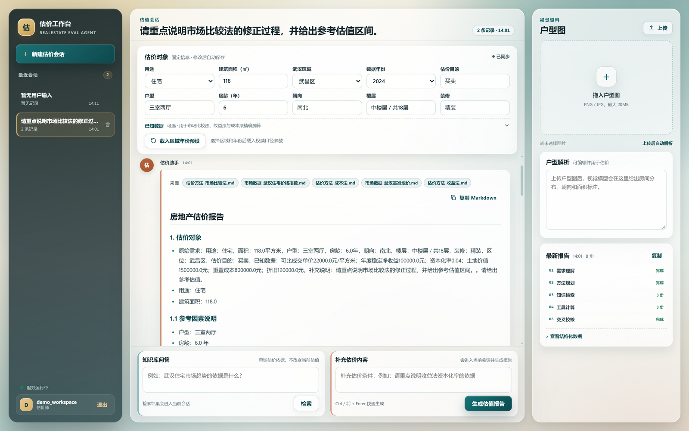
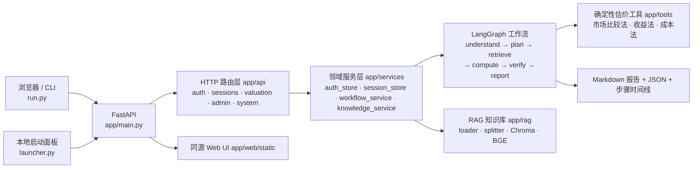
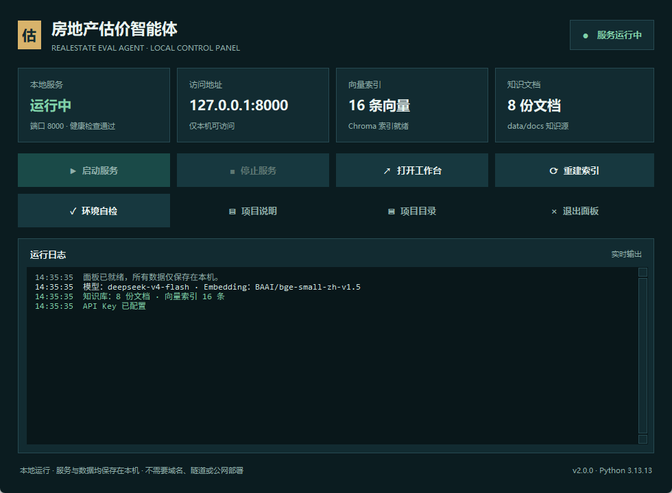
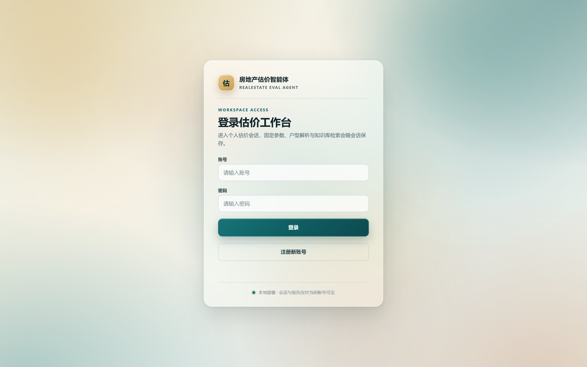
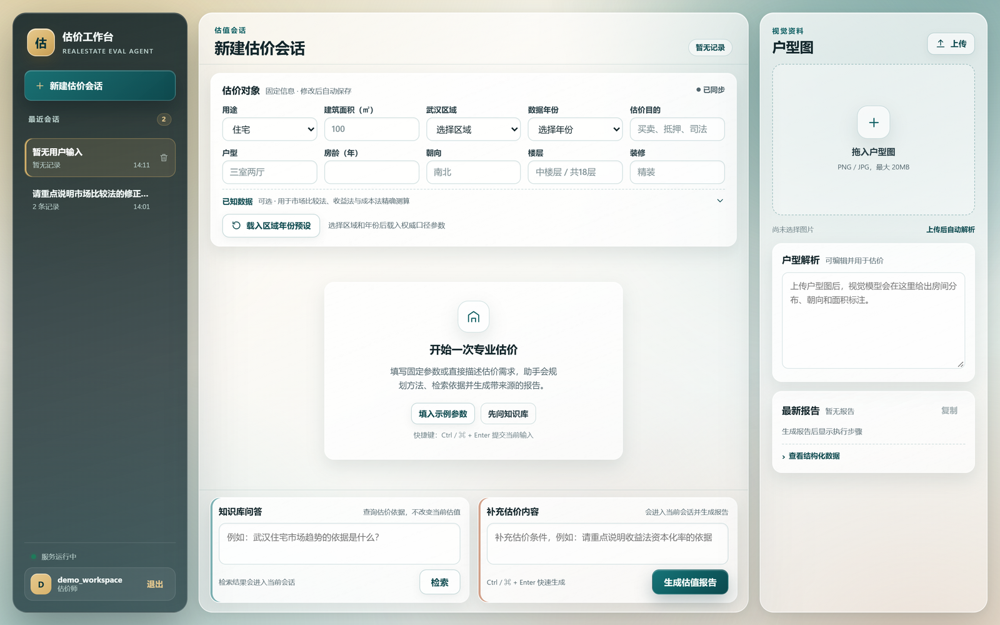
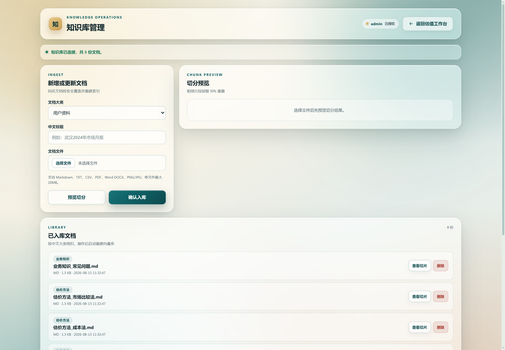
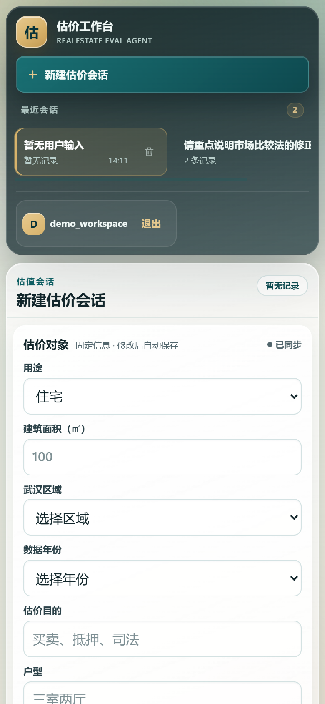

# 房地产估价智能体（RealEstate Eval Agent）

[](https://www.python.org/)
[](https://fastapi.tiangolo.com/)
[](https://langchain-ai.github.io/langgraph/)
[](https://www.trychroma.com/)
[](LICENSE)
[](https://github.com/moliu64/realestate-eval-agent/actions/workflows/tests.yml)

> 面向房地产估价场景的 **RAG + Tool Calling + LangGraph** 智能体工作台：把知识检索、确定性估价计算、多方法交叉校核与结构化报告串成一条可追踪的端到端链路。



## 项目简介

房地产估价既需要**规范知识**（方法口径、参数取值、政策依据），又需要**可复核的数值计算**，还要求结论能说明来源。本项目把这些组合为一个可演示的智能体系统：

```text
需求理解 → 方法规划 → 知识检索（RAG） → 确定性计算（Tool Calling） → 交叉校核 → 结构化报告
```

- **不确定的部分交给 LLM，确定的部分交给工具**：LLM 理解自然语言需求、规划估价方法、组织说明文字；市场比较法、收益法、成本法均由 Python 函数计算，金额与公式可逐项复核。
- **依据可追溯**：检索结果强制带 `[来源: 文件名]`，报告同时输出 Markdown 与结构化 JSON。
- **流程可观察**：Web 端展示执行步骤时间线，命令行可一键复现同一条工作流。

> **本项目为纯本地运行项目**：Web 服务、知识库、会话与向量索引都在本机，监听 `127.0.0.1:8000`，不需要域名、隧道或公网部署；模型调用只发往你在 `.env` 中配置的 API 端点。武汉区域年份预设为演示口径，**不替代正式估价报告**。

## 核心能力

| 能力 | 说明 |
| --- | --- |
| 多方法估价 | LangGraph 依次执行市场比较法、收益法、成本法；缺参数时明确标注，不编造结果 |
| 交叉校核 | 汇总各方法计算值，由 LLM 说明是否互相印证、差异原因与合理区间 |
| 武汉区域年份预设 | 15 个区/功能区、2019–2024 年，基于官方基准地价与二手住宅价格指数生成可编辑初测参数，标注「公式推导 / 估值假设」 |
| 多轮会话与账号隔离 | 登录后按账号拥有独立会话空间，读写前校验 `owner_id`，越权按不存在处理 |
| RAG 带来源引用 | Chroma + 本地 BGE Embedding，切片保留 10% 重叠；检索不到依据时明确拒答 |
| 户型图视觉解析 | 上传 png/jpg，视觉模型提取室厅、朝向、面积标注并写入当前会话 |
| 知识库管理 | 管理员上传/预览/删除 md、txt、csv、pdf、docx 与图片，同步重建向量库，失败回滚 |
| 双格式报告与步骤 | Markdown 报告 + `ReportSchema` JSON + 需求理解/规划/检索/计算/校核步骤时间线 |
| 一键本地启动面板 | Tkinter 桌面面板：启动/停止服务、打开工作台、重建索引、环境自检、实时日志与状态卡片 |
| 响应式 Web UI | FastAPI 同源提供静态页面，无独立前端与 CORS；桌面 / 平板 / 手机自适应 |

## 系统架构



**技术栈**

| 层次 | 技术 |
| --- | --- |
| 运行时 | Python 3.11+（标准库 Tkinter 提供启动面板） |
| Web | FastAPI、Uvicorn、Pydantic |
| 工作流 | LangGraph（状态图 + 条件路由） |
| LLM | LangChain、OpenAI 兼容 Chat API（DeepSeek / Qwen / GLM / OpenAI） |
| 检索 | Chroma、sentence-transformers、BGE Embedding |
| 视觉 | OpenAI 兼容 Vision API（默认 Qwen-VL 端点，可替换） |
| 前端与运行 | 原生 HTML / CSS / JavaScript；Tkinter 本地启动面板 |
| 测试 | unittest、TestClient、GitHub Actions |

**分层边界**

| 层次 | 目录 | 职责 |
| --- | --- | --- |
| 本地启动 | `launcher.py`、`start_panel.bat` | Tkinter 一键面板：管理本地服务进程、打开工作台、重建索引、环境自检、实时日志 |
| 应用装配 | `app/main.py` | 应用工厂、路由注册、`ServiceError` 异常映射、本地安全响应头 / 静态缓存中间件 |
| HTTP 层 | `app/api/` | 参数校验、Cookie 认证依赖、状态码；不写业务逻辑 |
| 服务层 | `app/services/` | 认证、会话、工作流编排、知识库操作；不依赖 FastAPI，抛领域异常 |
| 工作流 | `app/workflow/` | LangGraph 状态机：需求理解、方法规划、检索、计算、校核、报告 |
| 检索与工具 | `app/rag/`、`app/tools/` | 文档加载/切片/向量检索；纯函数估价计算，可单测、可被 Agent 复用 |
| 前端 | `app/web/static/` | 原生页面与脚本，同源调用 `/api/*` |

## 界面预览
**本地启动面板**（双击 `start_panel.bat`，或运行 `python run.py panel`）



| 登录页 | 工作台 |
| :---: | :---: |
|  |  |

| 知识库管理 | 移动端 |
| :---: | :---: |
|  |  |

## 快速开始

要求 Python 3.11+ 与一个 OpenAI 兼容文本模型端点；视觉模型与 BGE Embedding 模型按需配置。以下命令以 Windows PowerShell 为例。

### 1. 克隆并安装

```powershell
git clone https://github.com/moliu64/realestate-eval-agent.git
cd realestate-eval-agent
python -m venv .venv
.\.venv\Scripts\Activate.ps1
pip install -r requirements.lock   # 推荐可复现；或 pip install -r requirements.txt
Copy-Item .env.example .env
```

### 2. 配置 `.env`

至少填写文本模型；`.env` 已被 `.gitignore` 忽略，请勿提交真实密钥。

```dotenv
OPENAI_BASE_URL=https://api.deepseek.com/v1
OPENAI_API_KEY=sk-your-key
LLM_MODEL=deepseek-chat
```

| 服务 | `OPENAI_BASE_URL` | `LLM_MODEL` |
| --- | --- | --- |
| DeepSeek | `https://api.deepseek.com/v1` | `deepseek-chat` |
| Qwen / DashScope | `https://dashscope.aliyuncs.com/compatible-mode/v1` | `qwen-plus` |
| 智谱 GLM | `https://open.bigmodel.cn/api/paas/v4` | `glm-4-flash` |
| OpenAI | 留空（默认端点） | `gpt-4o-mini` |

视觉模型可选：`VISION_BASE_URL`、`VISION_API_KEY`、`VISION_MODEL`（默认 `qwen-vl-plus`）。管理员账号只能来自 `.env`：

```dotenv
AUTH_USERS_JSON={"admin":{"password":"REPLACE_WITH_STRONG_PASSWORD","role":"admin"}}
```

### 3. 构建向量库

```powershell
python run.py index
```

`app/__init__.py` 默认离线加载 Embedding。**首次下载模型**时需临时关闭离线模式，网络受限可加镜像：

```powershell
$env:HF_HUB_OFFLINE='0'; $env:TRANSFORMERS_OFFLINE='0'
$env:HF_ENDPOINT='https://hf-mirror.com'   # 可选
python run.py index
```

> 未构建向量库时，RAG 问答与估价工作流都会提示先运行 `python run.py index`；估算工具本身仍可独立单测。

### 4. 启动

```powershell
start_panel.bat            # 双击：打开本地启动面板
python run.py panel        # 等价的面板入口
python run.py web          # 直接启动 Web 工作台 http://127.0.0.1:8000
python run.py web --reload # 开发模式，代码变更自动重载
```

面板会自动探测 `http://127.0.0.1:8000/api/health`，服务未启动时可一键启动并打开浏览器；关闭面板会停止由它启动的服务进程。启动后打开 <http://127.0.0.1:8000>。

## 配置说明

全部配置来自环境变量或根目录 `.env`，由 `app/config.py` 启动时一次性加载。

| 变量 | 必填 | 默认值 | 说明 |
| --- | :---: | --- | --- |
| `OPENAI_BASE_URL` | 否 | 空（OpenAI 默认） | OpenAI 兼容 API 基址 |
| `OPENAI_API_KEY` | **是** | 无 | 文本模型密钥；缺失时估价工作流不可用 |
| `LLM_MODEL` | 否 | `gpt-4o-mini` | 文本模型名称 |
| `LLM_TIMEOUT_SECONDS` | 否 | `60` | 模型调用超时（秒） |
| `EMBEDDING_MODEL` | 否 | `BAAI/bge-small-zh-v1.5` | 本地 Embedding 模型 |
| `DOCS_DIR` / `VECTOR_DB_DIR` / `SESSIONS_DIR` / `AUTH_USERS_FILE` | 否 | `data/docs`、`data/vector_db`、`data/sessions`、`data/auth_users.json` | 知识源、Chroma、会话、注册用户路径 |
| `RETRIEVAL_TOP_K` | 否 | `4` | 检索返回切片数 |
| `MIN_RELEVANCE_SCORE` | 否 | `0.5` | 低于该相似度的切片不进入回答 |
| `VISION_BASE_URL` / `VISION_API_KEY` / `VISION_MODEL` | 否 | DashScope 端点 / 空 / `qwen-vl-plus` | 视觉模型；缺少密钥时户型图解析不可用 |
| `AUTH_USERS_JSON` | 建议 | `{}` | 管理员等固定账号；注册用户另存 `AUTH_USERS_FILE` |
| `APP_HOST` / `APP_PORT` / `LOG_LEVEL` | 否 | `127.0.0.1` / `8000` / `INFO` | 本地监听地址、端口与日志级别；保持 `127.0.0.1` 避免暴露 |
| `MAX_UPLOAD_MB` | 否 | `20` | 知识文档与户型图上传上限（MB） |

## 使用方式

### Web 工作台

1. **登录 / 注册并新建估价会话**：管理员账号来自 `.env` 的 `AUTH_USERS_JSON`，普通用户可在登录页注册；新建会话后填写用途、面积、区位、房龄、朝向、楼层、装修、估价目的等固定参数。
3. **载入武汉预设**：选择行政区与年份，自动填充可比单价、净收益、资本化率、土地价值、重置成本、折旧，可继续修改。
4. **上传户型图（可选）并提交补充说明**：解析结果写入会话；提交后生成 Markdown 报告、执行步骤时间线与折叠 JSON。
6. **知识库提问**：会话底部直接检索知识库，回答带来源 chips 并入会话记录。
7. **管理员入口**：`role=admin` 账号可从侧边栏进入 `/admin`，上传/预览/删除文档并重建向量库。

### 命令行

统一入口 `run.py`，默认子命令为 `web`。

```powershell
python run.py panel        # 打开本地启动面板
python run.py status       # 输出本地运行状态（JSON）
python run.py eval "帮我评估一套100平方米二手住宅，有近期可比成交单价20000元/平方米"
python run.py rag "收益法的资本化率怎么确定"      # 需先构建向量库
python run.py agent "某商铺年度稳定净收益60万元，资本化率5%，估值多少"
python run.py check --llm                        # 环境自检，--llm 发起真实模型请求
python run.py index                              # 重建本地向量索引
python run.py --help
```

## 目录结构

```text
realestate-eval-agent/
├── app/
│   ├── main.py / server.py     # 应用工厂 + 兼容入口（from app.main import app）
│   ├── local_runtime.py        # 本地状态读取（健康检查、文档数、向量数、collect_status）
│   ├── config.py / llm.py / embeddings.py / vision.py / presets.py / logging_config.py
│   ├── api/                    # auth、sessions、valuation、admin、system、deps、models
│   ├── services/               # auth_store、session_store、workflow_service、knowledge_service、errors
│   ├── workflow/               # graph、nodes、state、schemas
│   ├── rag/                    # loader、splitter、vectorstore、retriever、chain
│   ├── tools/valuation.py      # 市场比较法 / 收益法 / 成本法
│   ├── agent/                  # Tool Calling Agent
│   └── web/static/             # index.html、admin.html、app.js/admin.js/ui.js、styles.css
├── data/docs/                  # RAG 知识源：估价方法、武汉市场数据、规范、税费、业务知识
├── docs/                       # 架构、API、历史计划与评审、界面截图
├── scripts/indexing/           # 文档校验与向量库构建
├── tests/                      # unittest 测试与评估夹具
├── launcher.py                 # Tkinter 本地一键启动面板
├── run.py                      # 统一 CLI（web/panel/status/index/eval/rag/agent/check）
├── start_panel.bat             # 双击打开本地启动面板
├── start_backend.bat           # Windows 直接启动 Web 服务
├── requirements*.txt / requirements.lock
└── .env.example                # 环境变量模板（不含真实凭证）
```

运行时生成的 `data/sessions/`、`data/vector_db/`、`data/auth_users.json`、缓存与临时文件均由 `.gitignore` 排除。

## API 摘要

完整字段、权限与状态码见 [docs/API_ENDPOINTS.md](docs/API_ENDPOINTS.md)。`/api/openapi.json` 提供自动生成的 schema；Swagger UI 与 ReDoc 已关闭（`docs_url=None`、`redoc_url=None`）。

| 分组 | 方法与路径 | 认证 | 说明 |
| --- | --- | --- | --- |
| 系统 | `GET /api/health`、`/api/openapi.json` | 公开 | 健康检查 / OpenAPI schema |
| 认证 | `/api/auth/login`、`/register`（公开）；`/logout`、`/me`（可选） | 公开 / 可选 | 登录、注册与注销；查询当前登录态 |
| 会话 | `GET/POST /api/sessions` | 登录 | 会话列表 / 新建会话 |
| 会话 | `GET/PATCH/DELETE /api/sessions/{id}` | 所有者 | 详情 / 更新参数 / 删除 |
| 会话 | `POST /api/sessions/{id}/messages` | 所有者 | 提交估价消息并生成报告 |
| 会话 | `POST /api/sessions/{id}/rag` | 所有者 | 会话内知识库问答 |
| 估价 | `POST /api/evaluate`、`/api/ask` | 公开 | 无会话估价 / 自然语言问答 |
| 估价 | `POST /api/rag` | 登录 | 独立 RAG 问答 |
| 估价 | `GET /api/presets/options`、`/api/presets/wuhan` | 公开 | 预设选项 / 武汉区域年份参数 |
| 估价 | `POST /api/analyze-layout` | 公开 | 户型图视觉解析（上限 `MAX_UPLOAD_MB`） |
| 管理 | `GET /admin`、`/admin/access` | 管理员 | 管理页面（非管理员 302 → `/`）/ 权限校验 |
| 管理 | `POST /admin/preview`、`/admin/upload`；`GET/DELETE /admin/documents/*` | 管理员 | 切片预览 / 上传并重建索引 / 文档列表、预览与删除 |

## 测试

```powershell
pip install -r requirements-dev.txt
python -m unittest discover -s tests -v
```

测试使用标准库 `unittest` 与 Starlette `TestClient`，不依赖额外测试框架，当前共 37 个用例，覆盖工具计算、切片、预设、工作流节点、HTTP 合同、检索质量与本地状态读取。CI（`.github/workflows/tests.yml`）安装 `requirements-dev.txt`，执行 `compileall`（含 `launcher.py`）、`node --check`（app.js / admin.js / ui.js）与 `python -m unittest discover -s tests -v`。

- `tests/test_local_runtime.py`：覆盖文档计数、向量计数、服务探测与本地 URL；`tests/test_retriever.py` 在未构建向量库、向量库为空或 Embedding 模型不可用时自动 `skip`。
- `tests/test_agent.py`、`tests/test_workflow.py` 端到端用例：仅在 `RUN_LLM_TESTS=1` 时运行，需要真实 LLM。
- `tests/test_api.py`：使用临时目录与 `TestClient`，不调用真实模型，可离线运行。

## 本地启动与一键面板

推荐双击 `start_panel.bat` 打开面板（使用 `.venv\Scripts\pythonw.exe`，不弹控制台）。面板功能：

- **启动 / 停止服务**：调用 `python run.py web`，轮询 `/api/health` 确认就绪，停止时结束整个进程树。
- **打开工作台**：服务未启动时先启动，就绪后自动打开浏览器。
- **重建索引 / 环境自检**：流式显示 `run.py index`、`run.py check` 输出。
- **实时日志与状态卡片**：滚动展示服务日志（最近 600 行），每 2 秒刷新本地服务、访问地址、向量索引与知识文档数量。
- **快捷入口**：打开项目说明（README）与项目目录。

面板只管理**由它自己启动**的服务进程：如果服务已在运行（例如手动 `python run.py web`），面板会提示且不会接管或停止它；关闭面板时若其启动的服务仍在运行，会弹窗确认并停止，服务不会在后台残留。

```powershell
start_panel.bat            # 双击打开本地启动面板
python launcher.py         # 直接运行面板脚本
python run.py panel        # 通过统一 CLI 打开面板
python run.py web          # 直接启动 Web 服务，默认 http://127.0.0.1:8000
python run.py web --reload # 开发模式
python run.py status       # 输出 JSON 运行状态（服务、模型、文档数、向量数等）
```

修改 `.env` 或代码后需要重启服务；本地服务与数据均保留在本机，不存在远程部署或同步，模型请求只会发送到 `.env` 配置的 API 端点。

## 安全与边界

- **本地监听与单机边界**：默认只绑定 `127.0.0.1:8000`，不要改成 `0.0.0.0` 或把端口映射到公网；会话、注册账号、向量库都是本机文件，适合单用户 / 单实例演示；估价、视觉解析、RAG 会消耗所配置的模型额度，并把估价文本/检索上下文发送到对应 API 提供商，公开接口仅建议本机使用。如确需从其他设备访问，请自行增加 TLS、反向代理与限流，并自行承担风险。
- **密钥与登录态**：密钥只进 `.env`（已被忽略），仓库与文档不包含真实 API Key、密码或本机路径；Cookie `realestate_auth` 为 `HttpOnly` + `SameSite=Lax`，有效期 7 天，登录态保存在**进程内存**，服务重启后失效。
- **密码**：注册用户使用 PBKDF2-SHA256（260,000 轮）加盐哈希；`.env` 注入的管理员账号为明文比较，必须使用强密码并保护 `.env`。
- **隔离**：会话按 `owner_id`（`user:<username>`）过滤与校验，访问他人会话返回 404，不泄露存在性。
- **上传**：仅允许 md/txt/csv/pdf/docx/png/jpg/jpeg，大小受 `MAX_UPLOAD_MB`（默认 20MB）限制，文件名做路径穿越校验，重建失败回滚。
- **业务责任**：武汉预设数据是演示与流程验证口径，不能替代现场查勘、可比案例调查、宗地定位与正式估价报告。

## 路线图

- [ ] **持久化与多用户**：用户、会话、审计迁移到 SQLite/PostgreSQL，支持多 worker 与并发写入。
- [ ] **本地安装包与面板设置**：Windows 安装包 / 托盘常驻与开机自启；面板内编辑端口、模型与路径配置并查看历史运行记录。
- [ ] **评估集、更多城市与报告模板**：沉淀估价与检索回归集，跟踪 Recall@K、MRR、数值命中率与模型版本差异；扩展城市数据源，支持报告模板化导出 PDF / DOCX。

## 文档

- [架构说明](docs/ARCHITECTURE.md)
- [API 接口](docs/API_ENDPOINTS.md)
- [文档索引与历史记录](docs/README.md)
- [贡献指南](CONTRIBUTING.md)
- [安全策略](SECURITY.md)

本地启动说明以本 README「快速开始 / 本地启动与一键面板」与 [`launcher.py`](launcher.py) 为准；`docs/plans/` 与 `docs/reviews/` 为历史决策记录，其中提到的旧入口和旧配置可能已过时。

## 贡献

欢迎提交 Issue 与 Pull Request。开始前请阅读 [CONTRIBUTING.md](CONTRIBUTING.md)：保持 `api / services / rag / workflow / tools` 分层边界，新增接口同步更新 `docs/API_ENDPOINTS.md`，并确保 `unittest`、`compileall`、`node --check` 通过。请勿提交 `.env`、真实密钥、会话数据、注册账号文件或向量库。

## License

本项目采用 [MIT License](LICENSE)。
